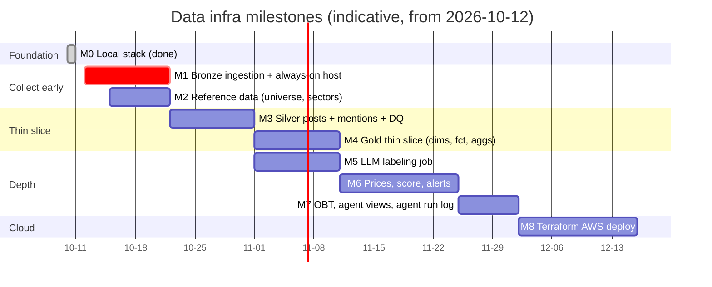

# Phases & Milestones

## 产品阶段
| Phase | 范围 | 状态 |
|---|---|---|
| **Phase 1（当前）** | StockTwits + Reddit 帖子 → LLM 标签 → 市场/行业/个股的 4h 指标 → score → 告警 + agent 解释；小时级价格用来评估 | 进行中 |
| Phase 2 | 历史 tick 回放（引入 Kafka）、恐慌指数（VIX、期限结构）、EPU、Trump 发帖事件研究 | 计划中 |
| Phase 3 | 模拟盘（Alpaca）、PnL 评估 | 计划中 |

## 基建里程碑（Jerry）
排期是指示性的，从 2026-10-12 开始按周算。和 plan §10 原顺序比，有一处改动：**Bronze 采集提到最前面**，因为 StockTwits 拿不到历史数据。

| M | 内容 | Plan step | 状态 | 被谁卡住 |
|---|---|---|---|---|
| M0 | 本地环境（Spark + RustFS + metastore + Delta + dbt + CI） | 1 | ✅ 2026-10-10 完成 | — |
| **M1** | Bronze 采集，7×24 运行：`sink.py`、`tables.py`（根据合约生成 DDL）、`state.py`、StockTwits/Reddit/小红书的 fetcher、grokbot 的 X 文件导入，再用一个 Spark append 任务写进 Delta。落地目录是 `<lake>/landing/<table>/`，**不能放在 `<lake>/brz/` 的表目录里**（VACUUM 会删掉 Delta log 没记录的文件） | 2 | **下一步（关键路径）** | Q2、Q7（先用临时名单）、Q8 |
| M2 | 参考数据：`dim_security`（SCD2，FIGI）、`dim_sector`、`etf_map` | 3 | 未开始 | Q2、Q3（SCD2 机制可以先用 fixture 做） |
| M3 | Silver：`posts`、`post_mentions`（规则部分）、`_quarantine`、`_dq_results`、按 watermark 增量处理 | 4、5 | 未开始 | `post_mentions` 依赖 M2 |
| M4 | Gold 薄切片（dbt）：维度表、`fct_post_sentiment`、三张 `agg_*_4h` | 6 | 未开始 | Q4、Q9 |
| M5 | LLM 打标签任务 → `post_labels` | 7 | 未开始 | Q5 |
| M6 | 价格、`fct_score`、`fct_alert`、`fct_alert_outcome` | 8、9 | 未开始 | Q1、Q6 |
| M7 | `obt_ticker_4h`、agent 视图、`fct_agent_run` | 10 | 未开始 | — |
| M8 | Terraform 部署到 AWS（EMR Serverless、Glue、S3、IAM） | 11 | 未开始 | — |

## 近期计划：brz + slv（2026-10-12 讨论过，还没开工）
**PR #1 `feat/brz-ingestion`**
1. `src/usse/tables.py`：`ensure_table(contract_path)`，读合约生成 `CREATE TABLE IF NOT EXISTS ... USING DELTA`。brz 和 slv 都要用，先做
2. 合约：`brz/_ingest_state.yml`、`brz/raw_reddit.yml`
3. `ingestion/sink.py`：`Sink` 协议 + `S3JsonSink`，写到 `ingest_date=.../<batch_id>.jsonl`
4. `ingestion/state.py`：读写 `_ingest_state`，重启后从 cursor 继续
5. `ingestion/stocktwits.py`：只负责抓取，记录外面包上元数据；HTTP 用 mock 测试；做限流和退避
6. Spark append 任务：JSONL → `brz.raw_stocktwits`

**PR #2 `feat/slv-posts`**
7. 合约：`slv/posts.yml`、`slv/_quarantine.yml`、`slv/_dq_results.yml`
8. `jobs/slv/posts.py`，写成纯函数：解析 → 转 UTC → `author_hash`（加盐 SHA-256）→ 去重（`ingest_ts` 取最早，会变的字段取最新）→ 垃圾帖标记 → 按 `post_id` MERGE
9. DQ：PK 唯一、`created_ts <= ingest_ts`；同一天重跑行数不变

先不做 `post_mentions` 的 as-of join，要等 M2。

**开工前要先验证的风险**：StockTwits 不再接受新开发者注册，无认证的 `streams/symbol/*.json` 可能被 Cloudflare 拦；Reddit 新应用可能要先审批。都**还没验证**，先用 curl 打一下。
